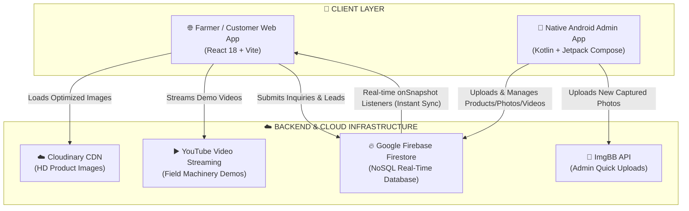
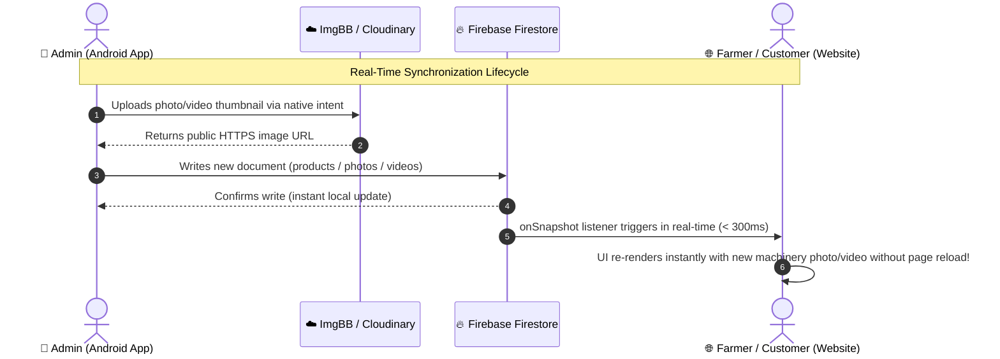

# 🌾 Padmashri Agro Services - Full System Architecture & File Structure

> **Comprehensive Technical Blueprint**: Breakdown of all files, frontend, backend, native Android admin app, cloud services, and programming languages used across the entire platform.

---

## 🏗️ 1. High-Level Architecture Overview

The Padmashri Agro Services ecosystem is built on a modern **Decoupled Real-Time Architecture**:



---

## 💻 2. Programming Languages & Tech Stack Summary

| Layer | Sub-System | Primary Languages | Frameworks & Libraries | Role & Responsibility |
| :--- | :--- | :--- | :--- | :--- |
| **Frontend Web** | Customer Portal | **JavaScript (ES6+)**, **JSX**, **CSS3**, **HTML5** | **React 18**, **Vite 5**, **React Router DOM**, **Lucide Icons** | High-performance responsive web app for farmers, buyers, and inquiries. |
| **Admin Native** | Android App | **Kotlin (1.9)**, **Kotlin DSL** | **Jetpack Compose**, **Material 3**, **Coil**, **Coroutines** | Native mobile app for administrators to add/edit products, photos, and videos with live sync. |
| **Database** | Cloud Backend | **NoSQL (JSON Docs)** | **Google Firebase Firestore** | Central real-time database syncing products, photos, videos, and customer inquiries. |
| **Media & CDN** | Media Infrastructure | **REST APIs**, **HTTP/JSON** | **Cloudinary**, **ImgBB API**, **YouTube Embeds** | Hosting, compressing, and delivering machinery photos and video demonstrations. |
| **DevOps & Tools** | Tooling & Scripts | **JavaScript (Node.js)**, **PowerShell** | **Node.js (ESM & CJS)**, **Vite**, **Gradle** | Database seeders, image migration, Android build automation, bundle generation. |

---

## 📁 3. Complete Directory & File Structure

```text
Padmashri Agro services/
│
├── 🌐 FRONTEND (Web Application)
│   ├── index.html                               # HTML5 entry point with SEO metadata
│   ├── vite.config.js                           # Vite bundler build & plugin configuration
│   ├── package.json                             # Web dependencies and build scripts
│   ├── package-lock.json                        # Exact pinned NPM dependency tree
│   ├── .env.example                             # Template for Firebase & Cloudinary env variables
│   ├── .env.local                               # Local environment secrets (ignored by Git)
│   │
│   ├── public/                                  # Static assets served as-is
│   │   ├── favicon.svg                          # Site favicon icon
│   │   ├── robots.txt                           # Web crawler instructions
│   │   ├── sitemap.xml                          # Search engine XML sitemap
│   │   └── llms.txt                             # LLM / AI indexing documentation
│   │
│   └── src/                                     # Web application source code
│       ├── main.jsx                             # React root bootstrap & DOM mounting
│       ├── App.jsx                              # Main app orchestrator with layout & routes
│       ├── firebase.js                          # Firebase initialization & Firestore export
│       ├── index.css                            # Complete CSS design system, variables & tokens
│       │
│       ├── components/                          # Modular React UI components
│       │   ├── Header.jsx                       # Top navigation, logo, phone call CTAs, Marathi/English
│       │   ├── HeroSection.jsx                  # Carousel banner showcasing tractors & trailers
│       │   ├── ProductCatalog.jsx               # Filterable product catalog with search & tags
│       │   ├── ProductDetailModal.jsx           # Centered modal with multi-angle gallery & specs table
│       │   ├── PriceCalculator.jsx              # Farmer subsidy & EMI monthly payment calculator
│       │   ├── PhotoGallery.jsx                 # Live photo showcase with Firestore onSnapshot sync
│       │   ├── VideoGallery.jsx                 # Live video showcase with YouTube iframe player
│       │   ├── BranchLocator.jsx                # Regional branches list (Satara, Kolhapur, etc.)
│       │   ├── InquiryModal.jsx                 # Lead form sending inquiry to WhatsApp & Firebase
│       │   ├── MobileStickyActionBar.jsx        # Sticky bottom quick Call & WhatsApp buttons
│       │   ├── Footer.jsx                       # Business info, address, GST, copyright
│       │   ├── LoadingSpinner.jsx               # UI loading indicator
│       │   ├── ResponsiveImage.jsx              # Cloudinary responsive image wrapper
│       │   ├── ErrorBoundary.jsx                # React crash recovery boundary
│       │   └── NotFound.jsx                     # 404 fallback page
│       │
│       ├── data/                                # Fallback & static datasets
│       │   ├── productsData.js                  # Default product catalog with specifications
│       │   ├── galleryData.js                   # 27 curated factory & machinery photos
│       │   ├── branchesData.js                  # Branch coordinates, contact numbers, addresses
│       │   └── cloudinaryAssets.js              # Cloudinary URLs mapping
│       │
│       ├── hooks/                               # Custom reusable React hooks
│       │   ├── useDebounce.js                   # Debounces fast search keystrokes
│       │   ├── useFocusTrap.js                  # Accessibility focus trapping in modals
│       │   └── useLocalStorage.js              # Persistent browser state storage
│       │
│       ├── lib/                                 # Third-party wrappers & helpers
│       │   ├── cloudinaryImage.js               # Cloudinary URL builder with auto-format/quality
│       │   └── imageUrl.js                      # Image fallback and URL sanitizer
│       │
│       └── utils/                               # Helper utilities
│           ├── validation.js                    # Form input validator (phone, name, email)
│           └── security.js                      # XSS sanitization and text safety
│
├── 📱 ANDROID ADMIN APP (PadmashriAdminNative)
│   ├── build.gradle.kts                         # Root Gradle build script
│   ├── settings.gradle.kts                      # Android project module definitions
│   ├── gradle.properties                        # JVM memory and AndroidX flags
│   ├── local.properties                         # Android SDK path configuration
│   ├── gradle/wrapper/                          # Gradle wrapper executable binaries
│   │
│   └── app/                                     # Admin Android application module
│       ├── build.gradle.kts                     # App dependencies (Compose, Firebase, Coil)
│       ├── google-services.json                 # Firebase project configuration for Android
│       └── src/main/
│           ├── AndroidManifest.xml              # Permissions (Internet), application setup
│           │
│           ├── java/com/padmashri/admin/        # Kotlin application codebase
│           │   ├── MainActivity.kt              # Main entry point & Jetpack Compose NavHost
│           │   │
│           │   ├── ui/screens/                  # App UI screens
│           │   │   ├── LoginScreen.kt           # Admin credential authentication screen
│           │   │   └── DashboardScreen.kt       # Complete Admin Management Center:
│           │   │       ├── Tab 0: Overview      # Live inventory counters, quick stats
│           │   │       ├── Tab 1: Products      # Real-time Add, Edit, Delete, Specs builder
│           │   │       ├── Tab 2: Photos        # ImgBB image upload, delete confirmation
│           │   │       ├── Tab 3: Videos        # 16:9 demo preview, YouTube auto-extract
│           │   │       └── Dialogs & Uploaders  # Modals for publishing machinery data
│           │   │
│           │   └── ui/theme/                    # Material 3 Design Tokens
│           │       ├── Color.kt                 # Padmashri agricultural green color palette
│           │       └── Theme.kt                 # Compose theme wrapper (typography, shapes)
│           │
│           └── res/                             # Android resources
│               ├── drawable/                    # Vector icons and graphical shapes
│               ├── mipmap-xxhdpi/               # App launcher icons
│               └── values/                      # strings.xml, themes.xml, colors.xml
│
├── ⚙️ AUTOMATION & SEEDING SCRIPTS (Root Directory)
│   ├── seed_gallery_videos.mjs                  # Node.js script seeding photos & videos to Firestore
│   ├── seed.js                                  # Node.js script seeding machinery catalog to Firestore
│   ├── convert.cjs                              # CommonJS helper script for data transformations
│   ├── test-cloudinary.js                       # Verification script for Cloudinary CDN uploads
│   ├── test-url-parsing.js                      # URL validation test script
│   └── scaffold_android.ps1                     # PowerShell automation script for Android scaffolding
│
└── 📁 SCRIPTS DIRECTORY (scripts/)
    ├── cloudinary-url-map.json                  # CDN asset identifier lookup map
    ├── upload-to-cloudinary.js                  # Batch asset uploader to Cloudinary
    ├── upload-cloudinary-images.mjs             # Media sync script
    └── generate-design-doc.mjs                  # Automated documentation builder
```

---

## 🔍 4. In-Depth Component & File Breakdown

### A. Frontend Web App (`src/`)

| File Path | Language | Key Responsibilities |
| :--- | :--- | :--- |
| `src/main.jsx` | JavaScript (React JSX) | Entry file. Injects `App.jsx` into the HTML DOM root (`<div id="root"></div>`). |
| `src/App.jsx` | JavaScript (React JSX) | Main application container. Manages active view state, modal triggers, and global inquiry context. |
| `src/firebase.js` | JavaScript (ESM) | Initializes Firebase App with client credentials and exports the `db` (`getFirestore()`) singleton. |
| `src/index.css` | Vanilla CSS3 | Core design system tokens: responsive grid, glassmorphism, typography, color palettes, animations, and modal styling. |
| `src/components/Header.jsx` | JavaScript (React JSX) | Brand logo, top contact hotline, language switcher, and smooth navigation links. |
| `src/components/HeroSection.jsx` | JavaScript (React JSX) | High-impact hero carousel with trust badges (ISO certified, 50,000+ happy farmers). |
| `src/components/ProductCatalog.jsx` | JavaScript (React JSX) | Search bar, category filters (Trailers, Rotavators, Cultivators), and cards displaying pricing and specs. |
| `src/components/ProductDetailModal.jsx` | JavaScript (React JSX) | Compact dialog displaying multi-image gallery, zebra-striped technical specs, and WhatsApp inquiry CTA. |
| `src/components/PhotoGallery.jsx` | JavaScript (React JSX) | Real-time photo gallery connected directly to Firestore `photos` collection with category filters and lightbox view. |
| `src/components/VideoGallery.jsx` | JavaScript (React JSX) | Real-time machinery demo videos connected to Firestore `videos` collection with automatic YouTube iframe conversion. |
| `src/components/PriceCalculator.jsx` | JavaScript (React JSX) | Financial calculator computing government agricultural subsidies and estimated monthly loan EMIs. |
| `src/components/BranchLocator.jsx` | JavaScript (React JSX) | Physical branch locator for Western Maharashtra (Satara, Karad, Kolhapur, Sangli, Pune). |
| `src/components/InquiryModal.jsx` | JavaScript (React JSX) | Lead capture modal sending verified customer inquiries directly to WhatsApp and Firebase. |
| `src/components/MobileStickyActionBar.jsx` | JavaScript (React JSX) | Sticky mobile bottom bar with quick single-tap "Call Now" and "WhatsApp Chat" actions. |

---

### B. Mobile Admin Native App (`PadmashriAdminNative/`)

| File Path | Language | Key Responsibilities |
| :--- | :--- | :--- |
| `MainActivity.kt` | Kotlin | App launch entry point. Configures Jetpack Compose `NavHost` routing between Login and Dashboard. |
| `LoginScreen.kt` | Kotlin (Compose) | Clean authentication interface verifying administrative login credentials. |
| `DashboardScreen.kt` | Kotlin (Compose) | **Core Admin Controller**: Manages 4 primary administrative modules with live snapshot listeners: |
| ↳ *Overview Tab* | Kotlin | Real-time statistics counters (`productsCount`, `photosCount`, `videosCount`) and quick action buttons. |
| ↳ *Products Tab* | Kotlin | Live Firestore product CRUD: adds, edits, deletes machinery, specifies HP, price ranges, and features. |
| ↳ *Photos Tab* | Kotlin | Live gallery management: picks photos from phone gallery, uploads to ImgBB cloud, and publishes to Firestore. |
| ↳ *Videos Tab* | Kotlin | 16:9 widescreen demo previews, auto-extracts YouTube thumbnails, provides intent-based video preview, and deletion confirmation. |
| `Theme.kt` & `Color.kt` | Kotlin | Defines Padmashri's green theme (`#15803D`, `#16A34A`), typography, and Material 3 design tokens. |

---

### C. Cloud Backend & Real-Time Database (`Firebase Firestore`)

| Collection Name | Document ID | Key Fields | Purpose |
| :--- | :--- | :--- | :--- |
| `products` | Auto / Custom ID | `name`, `nameMr`, `category`, `priceMin`, `priceMax`, `tractorHp`, `image`, `images`, `description`, `features`, `specs` | Stores all agricultural machinery details shown on the website catalog. |
| `photos` | Auto / Timestamp | `title`, `category`, `imageUrl`, `caption`, `createdAt` | Real-time photo showcase synchronized between Android admin and customer website. |
| `videos` | Auto / Timestamp | `title`, `category`, `videoUrl`, `thumbnailUrl`, `duration`, `createdAt` | Machinery video demos displayed on website with responsive YouTube embeds. |
| `inquiries` | Auto ID | `customerName`, `phone`, `productName`, `village`, `timestamp` | Customer lead records submitted via the website inquiry modal. |

---

## ⚡ 5. Real-Time Two-Way Synchronization Flow



---

## 🚀 6. How to Run Each Component

### A. Run the Customer Web Application
```bash
# 1. Install dependencies
npm install

# 2. Start local development server (Vite on port 3000)
npm run dev

# 3. Build optimized production bundle
npm run build
```

### B. Run the Native Android Admin App
1. Open the folder `PadmashriAdminNative` in **Android Studio**.
2. Allow Gradle to sync dependencies automatically.
3. Connect an Android phone via USB debugging or start an Android Emulator.
4. Click **Run 'app'** (`Shift + F10`) to build and launch the app.
