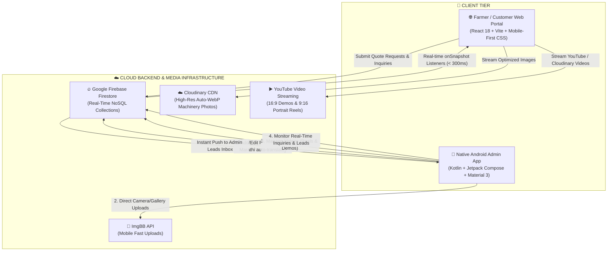
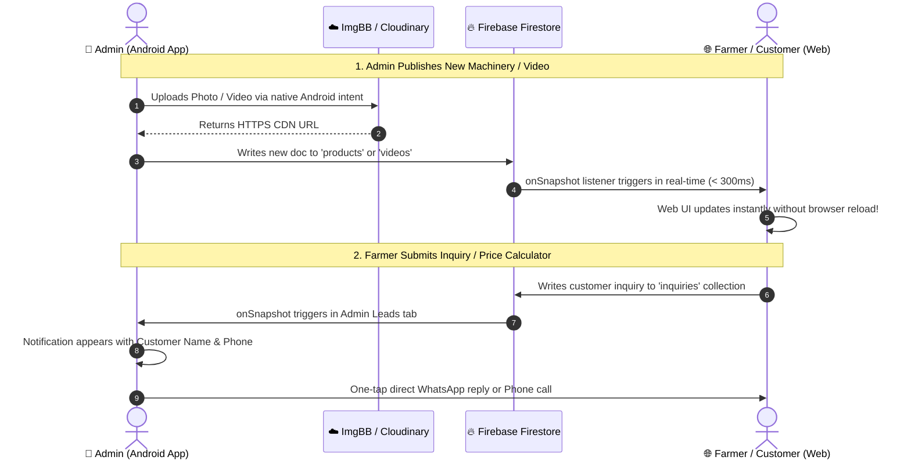

# 🌾 Padmashri Agro Services — Enterprise Ecosystem
### पद्मश्री ॲग्रो इंजिनिअरिंग वर्क्स (Sadatpur, Sangamner)

[](https://padmashri-agro.vercel.app)
[](Padmashri-Admin-v1.0.apk)
[](https://github.com/KaranMatade/PADMASHRI-AGRO)
[](https://firebase.google.com/)
[-3448c5?style=for-the-badge&logo=cloudinary)](https://cloudinary.com)

---

## 📋 1. Ecosystem Overview

**Padmashri Agro Engineering Works** is an enterprise-grade digital platform designed for an established manufacturer of heavy-duty agricultural equipment based in Sadatpur, Sangamner, Maharashtra (Est. 1998).

The platform consists of two synchronized systems connected to a shared cloud backbone:
1. **🌐 Farmer & Customer Web Portal**: A responsive, bilingual (Marathi & English) web application optimized for mobile farmers and B2B buyers with interactive price estimators, dual-mode video streaming (9:16 Reels & 16:9 Demos), technical specifications, and one-tap inquiry pipelines.
2. **📱 Native Android Admin Application (`PadmashriAdminNative`)**: A Kotlin & Jetpack Compose mobile app allowing factory administrators to manage machinery inventory, transliterate product names into Marathi with 1-click AI assistance, upload photos/videos, track real-time customer inquiries, and reply to farmers directly via WhatsApp and Phone.

---

## 🏗️ 2. High-Level System Architecture

The ecosystem utilizes a **Decoupled Real-Time Architecture** where any modification made in the Android Admin App reflects on the customer website in under 300ms without requiring page reloads:



---

## 💻 3. Technology Stack & Programming Languages

| Layer | Component | Languages | Frameworks & Libraries | Role & Responsibility |
| :--- | :--- | :--- | :--- | :--- |
| **Frontend Web** | Customer Portal | **JavaScript (ES6+)**, **JSX**, **CSS3**, **HTML5** | **React 18**, **Vite 5**, **Lucide Icons**, **Vaul**, **Sonner** | Ultra-fast responsive web application for farmers, catalog browsing, specs, and price estimation. |
| **Admin Native** | Android Application | **Kotlin (1.9)**, **Kotlin DSL** | **Jetpack Compose**, **Material 3**, **Coil**, **Coroutines**, **OkHttp** | Native Android admin console with live inventory CRUD, 1-click Marathi transliteration, photo upload, and lead dialer. |
| **Real-time DB** | Cloud Database | **NoSQL (JSON Documents)** | **Google Firebase Firestore** | Stores products, photos, videos, branch contacts, and customer inquiry leads. |
| **Media & CDN** | Media Pipelines | **REST APIs**, **HTTP/JSON** | **Cloudinary CDN**, **ImgBB API**, **YouTube IFrame API** | Compression, format auto-negotiation (WebP), and low-bandwidth delivery for rural mobile connectivity. |
| **Tooling & Build**| Automation | **Node.js (ESM/CJS)**, **PowerShell** | **Vite**, **Gradle 8.2**, **Android SDK 34** | Database seeders, asset migrators, Android compilation, and APK packaging. |

---

## 📁 4. Complete Project Directory & File Structure

```text
d:\Padmashri Agro services/
│
├── 🌐 FRONTEND WEB APPLICATION (React + Vite)
│   ├── index.html                                 # HTML5 document with structured SEO, Schema.org, Open Graph
│   ├── vite.config.js                             # Vite configuration with chunk splitting & asset optimizations
│   ├── package.json                               # Web dependencies (React, Lucide, Firebase, Vaul, Sonner)
│   ├── package-lock.json                          # Pinned dependency lockfile
│   ├── .env.example                               # Sample environment variables for Firebase & Cloudinary
│   ├── .env.local                                 # Local secrets (API keys, project IDs — Git ignored)
│   │
│   ├── public/                                    # Public static web assets
│   │   ├── favicon.svg                            # Modern agricultural leaf favicon
│   │   ├── robots.txt                             # SEO crawler instructions
│   │   ├── sitemap.xml                            # Search engine index XML sitemap
│   │   └── llms.txt                               # LLM & AI agent sitemap documentation
│   │
│   └── src/                                       # Application source code
│       ├── main.jsx                               # React DOM entry point with StrictMode
│       ├── App.jsx                                # Root container orchestrating layout, state & modals
│       ├── firebase.js                            # Firebase SDK init & Firestore db singleton export
│       ├── index.css                              # Master stylesheet: CSS variables, mobile grids, dark theme
│       │
│       ├── components/                            # Modular React UI components
│       │   ├── Header.jsx                         # Top navbar, hotline, language toggle, theme toggle, mobile drawer
│       │   ├── HeroSection.jsx                    # Hero banner with trust metrics (50k+ farmers, Est. 1998)
│       │   ├── ProductCatalog.jsx                 # Filterable catalog with search, category tabs & B2B/Grid view
│       │   ├── ProductDetailModal.jsx             # High-detail modal with multi-angle gallery, specs & WhatsApp CTA
│       │   ├── PriceCalculator.jsx                # Equipment price estimator by size, subsidy & transport calculation
│       │   ├── PhotoGallery.jsx                   # Live photo showcase with Firestore sync & lightbox modal
│       │   ├── VideoGallery.jsx                   # Dual-tier video showcase: 9:16 Vertical Reels & 16:9 Field Demos
│       │   ├── BranchLocator.jsx                  # Branch offices directory (Sangamner, Satara, Kolhapur, etc.)
│       │   ├── InquiryModal.jsx                   # Quote request form pushing leads to Firestore & WhatsApp
│       │   ├── MobileStickyActionBar.jsx          # Fixed bottom action bar: Call Now, WhatsApp, Get Quote
│       │   ├── Footer.jsx                         # Company information, GST, address, social links
│       │   ├── LoadingSpinner.jsx                 # Smooth animated loading indicator
│       │   ├── ResponsiveImage.jsx                # Cloudinary image wrapper with automatic WebP conversion
│       │   ├── ErrorBoundary.jsx                  # Graceful React crash recovery boundary
│       │   └── NotFound.jsx                       # 404 fallback page
│       │
│       ├── data/                                  # Static datasets & fallback seeds
│       │   ├── productsData.js                    # 8 heavy-duty implements with full specifications
│       │   ├── galleryData.js                     # 27 curated factory & implement photos
│       │   ├── branchesData.js                    # 4 regional branches with phone numbers & coordinates
│       │   └── cloudinaryAssets.js                # Cloudinary asset URL mapping
│       │
│       ├── hooks/                                 # Custom React hooks
│       │   ├── useContactData.js                  # Real-time contact numbers synced from Firestore
│       │   ├── useDebounce.js                     # Search input debounce hook (300ms)
│       │   ├── useFocusTrap.js                    # Accessibility keyboard trap for dialogs
│       │   └── useLocalStorage.js                # Persistent client preferences (theme, language)
│       │
│       ├── lib/                                   # Helper libraries
│       │   ├── cloudinaryImage.js                 # Cloudinary transformation URL generator
│       │   └── imageUrl.js                        # Safe image fallback and validator
│       │
│       └── utils/                                 # Utility functions
│           ├── validation.js                      # Form field validation (phone, email, text)
│           └── security.js                        # XSS escaping & text sanitization
│
├── 📱 NATIVE ANDROID ADMIN APP (PadmashriAdminNative)
│   ├── Padmashri-Admin-v1.0.apk                   # Pre-compiled standalone signed Android APK (21.8 MB)
│   ├── build.gradle.kts                           # Root Gradle project configuration
│   ├── settings.gradle.kts                        # Gradle module declarations
│   ├── gradle.properties                          # JVM configuration and AndroidX settings
│   ├── local.properties                           # Local Android SDK directory link
│   ├── gradlew / gradlew.bat                      # Gradle wrapper executables
│   │
│   └── app/                                       # Main Android application module
│       ├── build.gradle.kts                       # App dependencies: Compose, Firebase, Coil, Material 3
│       ├── google-services.json                   # Firebase Android configuration file
│       └── src/main/
│           ├── AndroidManifest.xml                # Permissions (INTERNET, READ_MEDIA_IMAGES), app setup
│           │
│           ├── java/com/padmashri/admin/          # Kotlin source code
│           │   ├── MainActivity.kt                # Jetpack Compose entry point & NavHost router
│           │   │
│           │   ├── ui/screens/                    # Jetpack Compose UI screens
│           │   │   ├── LoginScreen.kt             # Administrative login verification
│           │   │   └── DashboardScreen.kt         # Core Admin Management Hub (Tabs 0 to 5):
│           │   │       ├── Tab 0: Overview        # Live counters (Products, Photos, Videos, Leads)
│           │   │       ├── Tab 1: Products        # Real-time CRUD with 1-click Marathi auto-transliterate
│           │   │       ├── Tab 2: Photos          # Image gallery picker, ImgBB upload, categories
│           │   │       ├── Tab 3: Videos          # 9:16 Reels & 16:9 Demos uploader & YouTube parser
│           │   │       ├── Tab 4: Leads           # Real-time incoming web inquiries with Call & WhatsApp
│           │   │       └── Tab 5: Settings        # Factory phone, WhatsApp, and branch contact editor
│           │   │
│           │   └── ui/theme/                      # Material 3 design system
│           │       ├── Color.kt                   # Brand agricultural green & amber color palette
│           │       └── Theme.kt                   # Typography, shapes, and color scheme mapping
│           │
│           └── res/                               # Android resource assets
│               ├── drawable/                      # Vector drawables & brand iconography
│               ├── mipmap-xxhdpi/                 # High-resolution launcher icons
│               └── values/                        # strings.xml, colors.xml, themes.xml
│
├── ⚙️ SCRIPTS & CLOUD AUTOMATION (Root & scripts/)
│   ├── seed_gallery_videos.mjs                    # Seeds Firestore with vertical reels and widescreen videos
│   ├── seed.js                                    # Seeds Firestore with product catalog implements
│   ├── seed_contact.mjs                           # Seeds contact information into Firestore
│   ├── convert.cjs                                # CJS utility converting datasets
│   ├── test-cloudinary.js                         # Tests Cloudinary upload and response signatures
│   ├── test-url-parsing.js                        # Validates YouTube video ID and format parsers
│   ├── scaffold_android.ps1                       # Automated Android project setup script
│   │
│   └── scripts/                                   # Additional build scripts
│       ├── cloudinary-url-map.json                # Local-to-Cloudinary CDN URL mapping table
│       ├── upload-to-cloudinary.js                # Batch uploader for catalog imagery
│       ├── upload-cloudinary-images.mjs           # ESM media sync utility
│       └── generate-design-doc.mjs                # Design document generator
│
└── 📄 DOCUMENTATION
    ├── README.md                                  # This master documentation file
    ├── PROJECT_ARCHITECTURE_AND_FILE_STRUCTURE.md # Detailed architectural blueprint
    └── CLOUDINARY_OPTIMIZATION.md                 # Image optimization & CDN performance guide
```

---

## 🔍 5. Deep-Dive Component Breakdown

### A. Frontend Web Components (`src/components/`)

| Component | Key Responsibilities |
| :--- | :--- |
| **`Header.jsx`** | Sticky glassmorphic navbar with logo, live Marathi/English toggle, Dark/Light mode switcher, call hotlines, and smooth sliding mobile drawer. |
| **`HeroSection.jsx`** | High-impact hero section with localized Marathi heading, trust badges (28+ years experience, 50,000+ farmers), and fast navigation buttons. |
| **`ProductCatalog.jsx`** | Complete catalog supporting category filters (Ploughs, Trailers, Rotavators), keyword search, and dual view modes (Visual Cards vs B2B Specs List). |
| **`ProductDetailModal.jsx`** | Accessible dialog displaying multi-angle implement photos, zebra-striped technical specs (HP requirements, weight, blades), and direct WhatsApp order CTA. |
| **`PriceCalculator.jsx`** | Interactive finance estimator allowing farmers to pick implements, adjust specifications (blades, feet, tonnage), calculate government subsidies, and estimate monthly EMIs. |
| **`VideoGallery.jsx`** | **Dual-Tier Video Streaming**: Upside shows **9:16 Instagram Reels / YouTube Shorts** in a mobile 2-column grid; Downside shows **16:9 Widescreen Field Demonstrations** with responsive video players. |
| **`PhotoGallery.jsx`** | Real-time photo showcase synchronized with Firestore `photos` collection, complete with category pills and full-screen lightbox modal. |
| **`BranchLocator.jsx`** | Interactive branch list (Sangamner Head Office, Satara, Kolhapur, etc.) with direct dialing links and Google Maps directions. |
| **`InquiryModal.jsx`** | Direct lead capture form with validation that writes customer inquiries to Firestore `'inquiries'` and opens a pre-filled WhatsApp message. |
| **`MobileStickyActionBar.jsx`**| Fixed bottom mobile bar providing single-tap "Call Now", "WhatsApp", and "Get Quote" triggers without obscuring page content. |
| **`Footer.jsx`** | Comprehensive footer with factory address, GSTIN, working hours, IndiaMART trust badge, and copyright notice. |

---

### B. Native Android Admin Application (`PadmashriAdminNative/`)

| Android File / Tab | Functionality & Features |
| :--- | :--- |
| **`MainActivity.kt`** | Launches the application, initializes Firebase, and hosts Compose `NavHost` handling navigation between `LoginScreen` and `DashboardScreen`. |
| **`LoginScreen.kt`** | Secure PIN / credential authentication gate preventing unauthorized access to factory inventory. |
| **`DashboardScreen.kt`** | **The central admin command hub** housing 6 real-time modules: |
| ↳ **Tab 0: Overview** | Live statistical dashboard showing total active products, photo count, video count, and pending inquiry leads. |
| ↳ **Tab 1: Products** | Add, edit, or delete agricultural machinery in Firestore. Features a **1-Click AI Transliteration Button** that automatically translates English product names and descriptions into authentic Marathi. |
| ↳ **Tab 2: Photos** | Allows the admin to snap a photo in the factory or pick from phone gallery, uploads directly to ImgBB CDN, and publishes to Firestore with category tags. |
| ↳ **Tab 3: Videos** | Video showcase management supporting both **9:16 Vertical Reels** and **16:9 Horizontal Demos**. Auto-parses YouTube URLs to extract thumbnails or accepts direct cloud video URLs. |
| ↳ **Tab 4: Leads** | **Real-time Inquiry Inbox**: Shows every inquiry submitted by farmers on the website (Name, Phone, Village, Implement of interest). Features direct **"Call Customer"** and **"Reply on WhatsApp"** buttons. |
| ↳ **Tab 5: Settings** | Change the factory's primary hotline, WhatsApp number, and branch addresses in real time across the entire website. |

---

## 🗄️ 6. Cloud Database Schema (Firebase Firestore)

The application utilizes 5 core NoSQL collections in Firestore:

### 1. `products` Collection
```json
{
  "id": "hydraulic-reversible-plough-2mb",
  "name": "Hydraulic Reversible Plough 2MB",
  "nameMr": "हायड्रॉलिक रिव्हर्सिबल नांगर २ बॉटम",
  "category": "plough",
  "priceMin": 85000,
  "priceMax": 115000,
  "tractorHp": "45 - 55 HP",
  "image": "https://res.cloudinary.com/bthbndrq/image/upload/v1786167232/padmashri-agro/products/hydraulic_plough_1.jpg",
  "images": [
    "https://res.cloudinary.com/bthbndrq/image/upload/v1786167232/padmashri-agro/products/hydraulic_plough_1.jpg"
  ],
  "description": "Heavy-duty reversible plough designed for deep tillage in hard Maharashtra black cotton soil.",
  "descriptionMr": "महाराष्ट्रातील काळ्या कसदार जमिनीसाठी अत्यंत उपयुक्त, मजबूत हायड्रॉलिक रिव्हर्सिबल नांगर.",
  "features": ["Boron steel blades", "Reinforced box frame", "Dual hydraulic cylinders"],
  "featuresMr": ["बोरोन स्टीलचे फाळ", "मजबूत हेवी-ड्युटी फ्रेम", "ड्युअल हायड्रॉलिक सिलिंडर"],
  "specs": {
    "Tractor Power": "45 - 55 HP",
    "Weight": "420 kg",
    "Plough Depth": "12 - 14 inches"
  },
  "updatedAt": "2026-10-21T08:30:00Z"
}
```

### 2. `photos` Collection
```json
{
  "id": "photo_1729500000",
  "title": "Tipping Trailer Factory Dispatch",
  "titleMr": "हायड्रॉलिक ट्रेलर फॅक्टरी डिस्पॅच",
  "category": "Trailer",
  "imageUrl": "https://i.ibb.co/example/trailer-dispatch.jpg",
  "caption": "Delivered to customer in Kolhapur",
  "createdAt": "2026-10-21T09:15:00Z"
}
```

### 3. `videos` Collection
```json
{
  "id": "vid_1729501000",
  "title": "2MB Reversible Plough Field Test",
  "titleMr": "२ बॉटम रिव्हर्सिबल नांगर थेट शेतात चाचणी",
  "orientation": "vertical",
  "videoType": "youtube",
  "videoUrl": "https://youtube.com/shorts/dQw4w9WgXcQ",
  "thumbnail": "https://img.youtube.com/vi/dQw4w9WgXcQ/hqdefault.jpg",
  "duration": "0:45",
  "category": "Field Demo",
  "createdAt": "2026-10-21T10:00:00Z"
}
```

### 4. `inquiries` Collection
```json
{
  "id": "inq_1729502000",
  "customerName": "Ramesh Patil",
  "phone": "9822012345",
  "village": "Sangamner",
  "productName": "Hydraulic Reversible Plough 2MB",
  "source": "Website Price Calculator",
  "message": "Interested in 50 HP model with subsidy details.",
  "timestamp": "2026-10-21T11:20:00Z"
}
```

### 5. `contactData` Collection
```json
{
  "id": "main",
  "mainPhone": "9226253710",
  "whatsapp": "919226253710",
  "email": "contact@padmashreeagro.com",
  "officeAddress": "Loni-Sadatpur Road, Sadatpur, Tal: Sangamner, Dist: Ahilyanagar, Maharashtra 413736",
  "officeHours": "8:00 AM - 8:00 PM (Daily)"
}
```

---

## ⚡ 7. Real-Time Two-Way Synchronization Flow



---

## 🚀 8. Getting Started & Installation

### A. Customer Web Application

```bash
# 1. Clone the repository
git clone https://github.com/KaranMatade/PADMASHRI-AGRO.git
cd PADMASHRI-AGRO

# 2. Install dependencies
npm install

# 3. Configure environment variables
# Create a .env.local file with your Firebase credentials:
# VITE_FIREBASE_API_KEY=your_api_key
# VITE_FIREBASE_AUTH_DOMAIN=your_auth_domain
# VITE_FIREBASE_PROJECT_ID=your_project_id
# VITE_FIREBASE_STORAGE_BUCKET=your_storage_bucket
# VITE_FIREBASE_MESSAGING_SENDER_ID=your_sender_id
# VITE_FIREBASE_APP_ID=your_app_id

# 4. Start local development server
npm run dev
# Running at: http://localhost:3000

# 5. Build for production
npm run build
# Outputs optimized bundle to dist/
```

### B. Native Android Admin Application

#### Option 1: Direct APK Installation (Fastest)
1. Transfer the pre-built `Padmashri-Admin-v1.0.apk` located in the root of this repository directly to your Android device via USB, WhatsApp, or Google Drive.
2. Tap the APK on your phone and select **Install** (enable "Install from Unknown Sources" if prompted).
3. Open **Padmashri Admin** and sign in.

#### Option 2: Build from Source in Android Studio
1. Open Android Studio (Hedgehog or newer recommended).
2. Select **Open** and choose the `d:\Padmashri Agro services\PadmashriAdminNative` folder.
3. Wait for Gradle sync to complete.
4. Ensure `google-services.json` is present in `PadmashriAdminNative/app/`.
5. Connect an Android phone with USB Debugging enabled (or start an Android Virtual Device).
6. Press **Run 'app'** (`Shift + F10`) or run:
   ```bash
   cd PadmashriAdminNative
   ./gradlew assembleDebug
   ```

---

## 🗓️ 9. Full-Stack Course Lesson Plan Alignment

This project was built to demonstrate enterprise full-stack software development principles:

| Sprint / Week | Topic | Practical Implementation in this Project |
| :--- | :--- | :--- |
| **Week 1** | Software Intro & Client Analysis | Analyzed Padmashri Agro's manufacturing workflow, farmer demographics in rural Maharashtra, and offline sales friction. |
| **Week 2** | SDLC & MVP Scoping | Shipped bilingual MVP with 8 implements, mobile hamburger navigation, and direct WhatsApp ordering. |
| **Week 3** | System Design & Role Specs | Authored architectural blueprint, established agricultural color palette (`#15803d` & `#d97706`), and planned component contracts. |
| **Week 4** | Design Documents & Flowcharts | Built complete data flow diagrams, technical specifications matrices, and customer journey maps. |
| **Week 5** | Coding Best Practices | Component modularity, DRY principles, strict CSS variable systems, semantic HTML5, and accessibility focus trapping. |
| **Week 6** | Version Control & Git Flow | Feature branches, descriptive commit standards (`feat:`, `fix:`, `style:`), untracked sensitive secrets (`.env.local`). |
| **Week 7** | Local Development & Sprint Cadence| Set up Vite bundler, NPM script pipelines, and fast HMR workflows for rapid iterations. |
| **Week 8** | CI/CD Deployment | Automated deployment pipeline via Vercel Edge Network on pushes to `main`. |
| **Week 9-10**| Cloud Databases & REST | Firebase Firestore integration for real-time synchronization between web and mobile devices. |
| **Week 11** | Mobile Architecture & Compose | Native Android application built with Kotlin, Jetpack Compose, Material 3, and Coroutines. |
| **Week 12** | Cloud Media & CDN Delivery | Integrated Cloudinary auto-formatting and ImgBB API for mobile photo uploads without server overhead. |
| **Week 13** | Multimedia Pipelines | Added dual-tier video gallery with 9:16 vertical reels and 16:9 widescreen YouTube embed parser. |
| **Week 14** | Lead Generation & Automation | Connected web price estimator and inquiry modal directly to the admin leads inbox with WhatsApp webhooks. |
| **Week 15** | Mobile UX Polish & APK Packaging | Optimized mobile viewports down to 360px and compiled standalone `Padmashri-Admin-v1.0.apk`. |

---

## 🔒 10. Security & Quality Assurance

- **Zero Hardcoded Secrets**: All Firebase and cloud credentials are kept in `.env.local` and `local.properties` (strictly git-ignored).
- **Input Sanitization**: XSS protection on farmer search queries and contact forms via `security.js`.
- **Responsive Viewport Testing**: Fully tested down to 360px width on devices like Redmi, Realme, and Samsung Galaxy M/A series.
- **Fail-Safe Fallbacks**: If internet connectivity is interrupted, the web portal automatically falls back to curated static datasets in `/src/data/`.

---

## 📞 11. Business & Contact Information

**Padmashri Agro Engineering Works**  
📍 Loni-Sadatpur Road, Sadatpur, Taluka: Sangamner  
District: Ahilyanagar (Ahmednagar), Maharashtra — 413736  
📞 **Hotline:** +91 92262 53710  
💬 **WhatsApp:** +91 92262 53710  
📧 **Email:** contact@padmashreeagro.com  
🌐 **Website:** [padmashri-agro.vercel.app](https://padmashri-agro.vercel.app)  
🏭 **IndiaMART Profile:** [Verified Seller Directory](https://www.indiamart.com/padmashriagroengworks/)  

---

*Built with ❤️ for Indian Agriculture | © 2026 Padmashri Agro Engineering Works*
